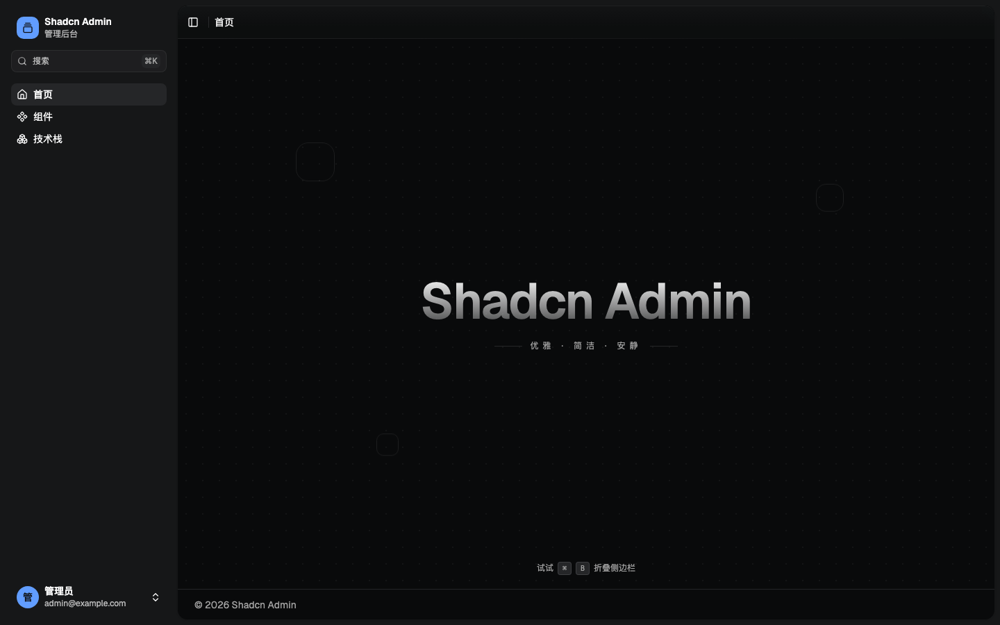

<h1 align="center">Shadcn Admin Template</h1>

<p align="center">
  English · <a href="./README_ZH-CN.md">简体中文</a>
</p>

<p align="center">
  A focused React admin starter with runtime theming,<br />
  a collapsible shell and a command palette.
</p>

<p align="center">
  <a href="./LICENSE"></a>
  
  
  
  
  
</p>

<p align="center">
  
</p>

## Branches

| Branch     | Purpose                                                              |
| ---------- | -------------------------------------------------------------------- |
| `main`     | Minimal starter: app shell + Home                                    |
| `showcase` | Full demo: Projects, table, Kanban, Upload, Components, SSE and more |

Use `main` when starting a new app. Browse `showcase` for full interaction examples.

## What is included

- **Runtime theming** — light/dark/system, theme presets, custom primary, surface and accent colors
- **Layout controls** — sidebar side, variant, collapse mode, width, header style and content width
- **No theme flash** — a pre-paint bootstrap script applies persisted theme settings before React mounts
- **Command palette** — search pages and actions with `⌘K`
- **Responsive shell** — collapsible sidebar, sticky header, inset content and footer
- **Error boundaries** — page and application fallbacks instead of a blank screen
- **Validated environment** — app name and API base URI are checked at startup
- **Strict tooling** — Oxlint (type-aware), Oxfmt, Husky and lint-staged

## Tech Stack

| Area      | Choice                                 |
| --------- | -------------------------------------- |
| Framework | React 19, TypeScript 7                 |
| Build     | Vite 8 + Rolldown, React Compiler      |
| Styling   | Tailwind CSS 4, `tw-animate-css`       |
| UI        | shadcn `base-nova`, Base UI primitives |
| Routing   | React Router 8                         |
| State     | Zustand 5                              |
| Hooks     | Mantine Hooks                          |
| Quality   | Oxlint, Oxfmt, Husky, lint-staged      |

## Requirements

- Node.js `^20.19.0 || >=22.12.0`
- pnpm 12+

## Quick Start

```bash
git clone git@github.com:rxxx979/react-ts-shadcn-template.git
cd react-ts-shadcn-template

pnpm install
cp .env.example .env
pnpm dev
```

Open <http://localhost:5173>.

### Full demo

```bash
git clone -b showcase git@github.com:rxxx979/react-ts-shadcn-template.git
cd react-ts-shadcn-template
pnpm install
cp .env.example .env
pnpm dev
```

## Use This Template

```bash
npx tiged rxxx979/react-ts-shadcn-template my-app
cd my-app
git init
cp .env.example .env
pnpm install
pnpm dev
```

`tiged` copies the repository without its Git history, so initialize a new repository yourself.

If you run `pnpm install` before `git init`, the Husky prepare step is skipped. After `git init`, run:

```bash
pnpm prepare
```

## Environment Variables

Copy the example file:

```bash
cp .env.example .env
```

| Variable            | Default        | Description                        |
| ------------------- | -------------- | ---------------------------------- |
| `VITE_APP_NAME`     | `Shadcn Admin` | Default application name           |
| `VITE_API_BASE_URI` | `/api`         | Base URI used by the request layer |

`.env` is ignored by Git. The template ships with `.env.example` only.

Environment values are validated at startup with Zod. Application name, theme and layout can also be changed at runtime from the appearance panel; settings are persisted in `localStorage`.

## Pages

`main` ships with the shell and a single page:

```text
/    Home
```

Add routes in `src/router/index.tsx` and place screens in `src/pages/`.

## Scripts

| Command            | Description                         |
| ------------------ | ----------------------------------- |
| `pnpm dev`         | Start the development server        |
| `pnpm build`       | Type-check and build for production |
| `pnpm preview`     | Preview the production build        |
| `pnpm lint`        | Run Oxlint                          |
| `pnpm lint:fix`    | Run Oxlint with automatic fixes     |
| `pnpm fmt`         | Format with Oxfmt                   |
| `pnpm fmt:check`   | Check formatting                    |
| `pnpm lint:staged` | Run lint-staged manually            |

## Project Structure

```text
src/
├── App.tsx
├── main.tsx
├── router/
│   ├── index.tsx
│   ├── navigation.ts
│   ├── navigation-context.ts
│   └── NavigationProvider.tsx
├── pages/
│   ├── Home.tsx
│   └── NotFound.tsx
├── components/
│   ├── layout/
│   ├── theme/
│   └── ui/
├── hooks/
├── lib/
├── stores/
└── styles/
```

- `pages/` — route-level screens
- `components/layout/` — application shell, sidebar, header, footer
- `components/theme/` — theme and appearance UI
- `components/ui/` — shadcn registry components
- `lib/` — request, theme and shared helpers
- `stores/` — persisted Zustand stores for theme, layout and app settings
- `router/index.tsx` — route table and page metadata

## Theme System

Theme, layout and app settings are split into three persisted Zustand stores:

- `stores/theme.ts` — mode, preset, colors, typography, radius, motion
- `stores/layout.ts` — sidebar side/variant/width, header style, content width, background pattern
- `stores/app.ts` — application name, tagline and UI visibility

The appearance panel writes to these stores and updates CSS variables in real time.

The small synchronous script in `index.html` reads the persisted theme before the first paint, preventing a flash of the wrong theme on reload.

## Request Layer

`src/lib/request.ts` provides a typed fetch wrapper:

```ts
import { request } from "@/lib/request";

const projects = await request<Project[]>("/projects", {
  query: { page: 1, pageSize: 20 },
});
```

It handles the base URI, query serialization, JSON bodies, `Result` unwrapping and `ApiError`.

## Error Handling

- `components/ErrorBoundary.tsx` catches render and lazy chunk failures
- `components/layout/PageError.tsx` keeps the layout shell and offers a retry
- `components/layout/RootError.tsx` covers application-level failures
- the root route also has an `errorElement`
- environment variables are validated before the app renders

## Git Hooks

- `.husky/pre-commit` runs `pnpm exec lint-staged`
- Staged JS/TS files: `oxlint --fix` + `oxfmt --write`
- Staged JSON/CSS/Markdown: `oxfmt --write`
- Fixed files are automatically re-staged

Without a Git repository the `prepare` script skips Husky installation. Run `pnpm prepare` after `git init`.

## Contributing

Issues and pull requests are welcome.

Before opening a PR, please run:

```bash
pnpm lint
pnpm build
```

Keep changes focused and match the existing visual language.

## License

[MIT](./LICENSE) © 2026 [rxxx979](https://github.com/rxxx979)

## Acknowledgements

Built with [React](https://react.dev), [Vite](https://vite.dev), [Tailwind CSS](https://tailwindcss.com), [shadcn](https://ui.shadcn.com), [Base UI](https://base-ui.com), [Lucide](https://lucide.dev) and [Geist](https://vercel.com/font).
