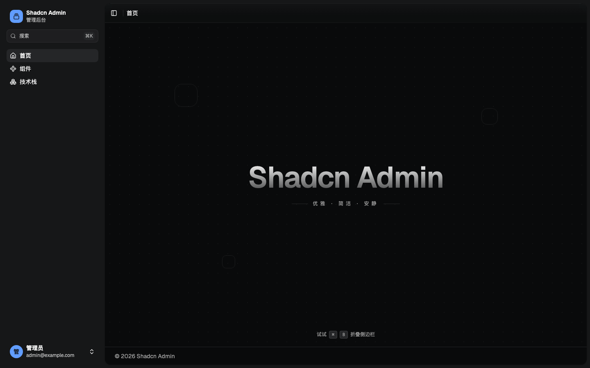

<h1 align="center">Shadcn Admin Template</h1>

<p align="center">
  一个注重细节的 React 后台模板，包含运行时主题、可折叠侧边栏、<br />
  Command Palette 和完整的组件画廊。
</p>

<p align="center">
  <a href="./README.md">English</a> · 简体中文
</p>

<p align="center">
  <a href="./LICENSE"></a>
  
  
  
  
  
</p>

<p align="center">
  
</p>

## 为什么选择这个模板

大多数后台模板只提供布局和少量页面。这个模板更关注那些让界面真正完整的细节：

- **运行时主题** — 明暗/跟随系统、主题预设、自定义品牌色、界面色与强调色
- **布局控制** — 侧边栏位置、变体、折叠模式、宽度、顶栏样式与内容宽度
- **无主题闪烁** — 首帧前同步应用持久化主题，避免刷新时闪白
- **Command Palette** — 使用 `⌘K` 搜索页面与操作
- **组件画廊** — 可浏览的 shadcn/Base UI 组件展示
- **细节默认值** — 浮层滚动条、减少动效支持、响应式布局与键盘快捷键
- **类型安全的请求层** — `request` 客户端与 `useRequest` Hook，处理竞态与取消
- **严格工具链** — Oxlint（type-aware）、Oxfmt、Husky 与 lint-staged

## 技术栈

| 领域        | 选择                                   |
| ----------- | -------------------------------------- |
| 框架        | React 19、TypeScript 7                 |
| 构建        | Vite 8 + Rolldown、React Compiler      |
| 样式        | Tailwind CSS 4、`tw-animate-css`       |
| UI          | shadcn `base-nova`、Base UI primitives |
| 路由        | React Router 8                         |
| 状态        | Zustand 5                              |
| Hooks       | Mantine Hooks                          |
| 数据 / 内容 | Recharts、Shiki                        |
| 质量        | Oxlint、Oxfmt、Husky、lint-staged      |

## 环境要求

- Node.js `^20.19.0 || >=22.12.0`
- pnpm 10+

## 快速开始

```bash
git clone git@github.com:rxxx979/react-ts-shadcn-template.git
cd react-ts-shadcn-template

pnpm install
cp .env.example .env
pnpm dev
```

打开 <http://localhost:5173>。

## 使用这个模板

### tiged

```bash
npx tiged rxxx979/react-ts-shadcn-template my-app
cd my-app
git init
cp .env.example .env
pnpm install
pnpm dev
```

`tiged` 只会复制文件，不会携带原仓库的 Git 历史，所以需要自己初始化仓库。

如果在 `git init` 之前执行了 `pnpm install`，Husky 的 prepare 步骤会被跳过。`git init` 之后运行：

```bash
pnpm prepare
```

如果仓库已经标记为 GitHub Template，也可以直接使用 **Use this template** 按钮。

## 环境变量

复制示例文件：

```bash
cp .env.example .env
```

| 变量                | 默认值         | 说明           |
| ------------------- | -------------- | -------------- |
| `VITE_APP_NAME`     | `Shadcn Admin` | 应用默认名称   |
| `VITE_API_BASE_URI` | `/api`         | 请求层基础 URI |

应用名、主题和布局也可以在运行时通过外观面板修改，配置会持久化到 `localStorage`。

## 脚本

| 命令               | 说明                   |
| ------------------ | ---------------------- |
| `pnpm dev`         | 启动开发服务器         |
| `pnpm build`       | 类型检查并构建生产产物 |
| `pnpm preview`     | 预览生产构建           |
| `pnpm lint`        | 运行 Oxlint            |
| `pnpm lint:fix`    | 运行 Oxlint 并自动修复 |
| `pnpm fmt`         | 使用 Oxfmt 格式化      |
| `pnpm fmt:check`   | 检查格式               |
| `pnpm lint:staged` | 手动运行 lint-staged   |

## 目录结构

```text
src/
├── App.tsx
├── main.tsx
├── router/
│   ├── index.tsx
│   └── Lazy.tsx
├── pages/
│   ├── Home.tsx
│   ├── Components.tsx
│   ├── Stack.tsx
│   └── NotFound.tsx
├── components/
│   ├── OverlayScrollbar.tsx
│   ├── layout/
│   ├── theme/
│   └── ui/
├── config/
├── hooks/
├── lib/
├── stores/
└── styles/
```

- `pages/` — 路由级页面
- `components/layout/` — 应用壳层、侧边栏、顶栏、页脚
- `components/theme/` — 主题与外观面板
- `components/ui/` — shadcn registry 组件
- `lib/` — 请求、主题工具与共享类型
- `stores/` — 主题、布局与应用设置的持久化 Zustand store

## 主题系统

主题、布局和应用设置拆分为三个持久化 Zustand store：

- `stores/theme.ts` — 模式、预设、颜色、字体、圆角、动效
- `stores/layout.ts` — 侧边栏位置/变体/宽度、顶栏样式、内容宽度、背景纹理
- `stores/app.ts` — 应用名称、副标题与界面可见性

外观面板写入这些 store，并实时更新 CSS 变量。

`index.html` 中的同步脚本会在首帧前读取持久化主题，避免刷新时出现错误的主题闪烁。

## 请求层

`src/lib/request.ts` 提供类型安全的 fetch 封装：

```ts
import { request } from "@/lib/request";

const projects = await request<Project[]>("/projects", {
  query: { page: 1, pageSize: 20 },
});
```

它处理基础 URI、query 序列化、JSON body、`Result` 解包与 `ApiError`。

`src/hooks/use-request.ts` 提供 React Hook：

```ts
const { data, loading, error, refresh, cancel } = useRequest((signal) => request<Project[]>("/projects", { signal }));
```

Hook 管理 `data / loading / error`，忽略过期响应，在卸载时中止在途请求，并暴露 `run`、`refresh`、`cancel` 和 `mutate`。

## Git Hooks

- `.husky/pre-commit` 执行 `pnpm exec lint-staged`
- 暂存的 JS/TS 文件：`oxlint --fix` + `oxfmt --write`
- 暂存的 JSON/CSS/Markdown：`oxfmt --write`
- 修复后的文件会自动重新暂存

没有 Git 仓库时，`prepare` 会跳过 Husky 安装。`git init` 后运行 `pnpm prepare` 即可。

## 贡献

欢迎提交 Issue 和 Pull Request。

提交 PR 前请先运行：

```bash
pnpm lint
pnpm build
```

保持改动聚焦，并遵循现有的视觉语言。

## License

[MIT](./LICENSE) © 2026 [rxxx979](https://github.com/rxxx979)

## 致谢

使用 [React](https://react.dev)、[Vite](https://vite.dev)、[Tailwind CSS](https://tailwindcss.com)、[shadcn](https://ui.shadcn.com)、[Base UI](https://base-ui.com)、[Lucide](https://lucide.dev) 和 [Geist](https://vercel.com/font) 构建。
